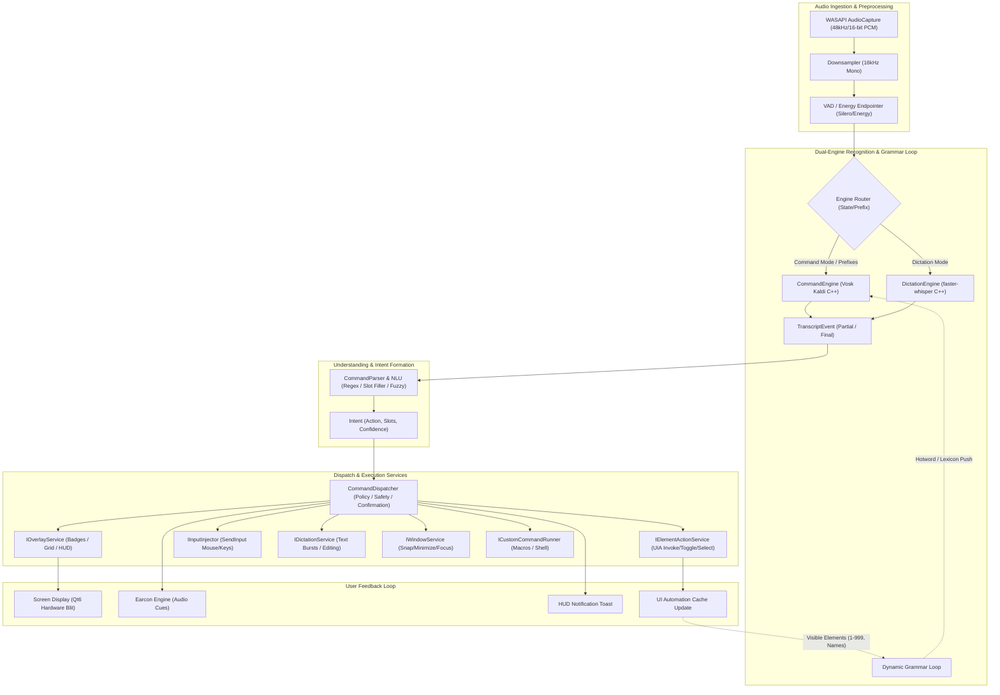
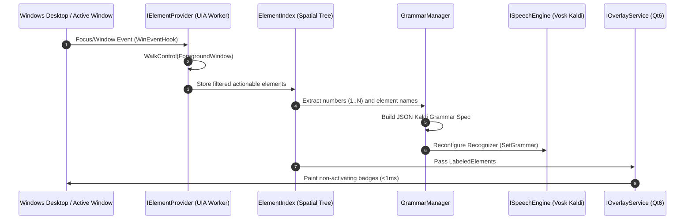
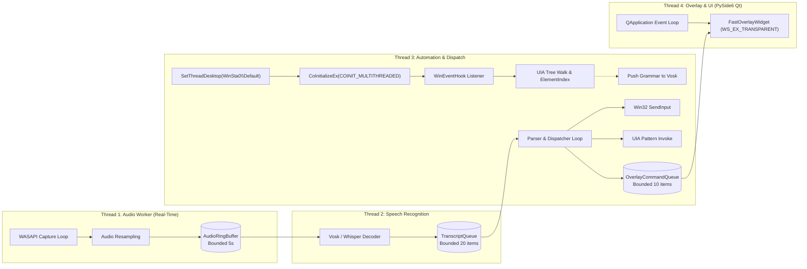
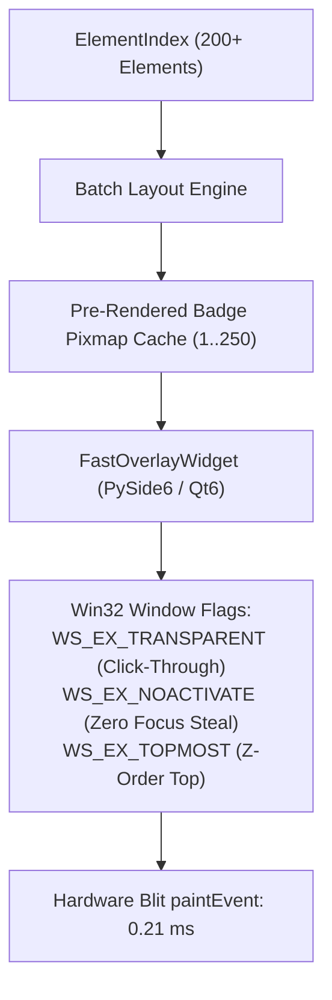
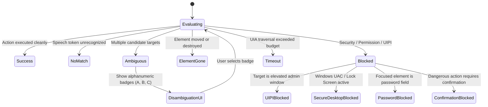
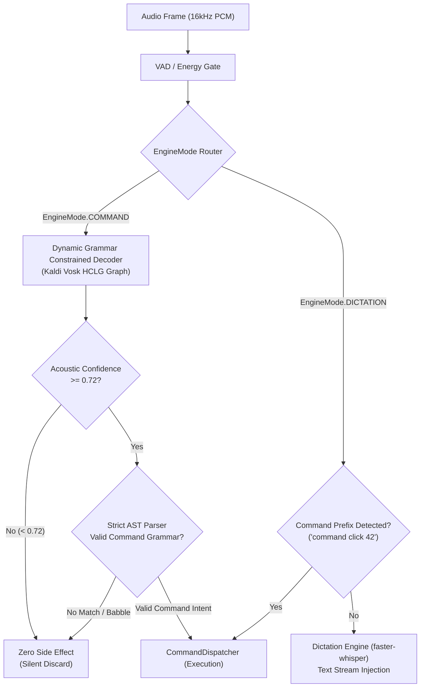
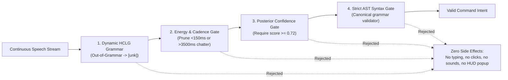
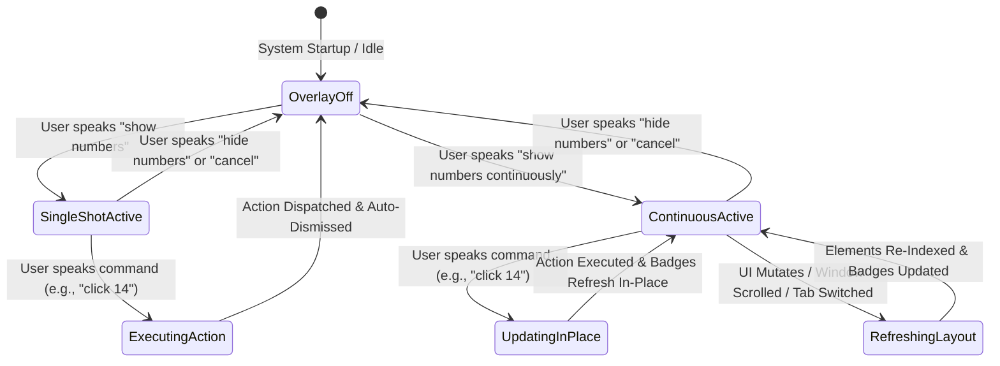
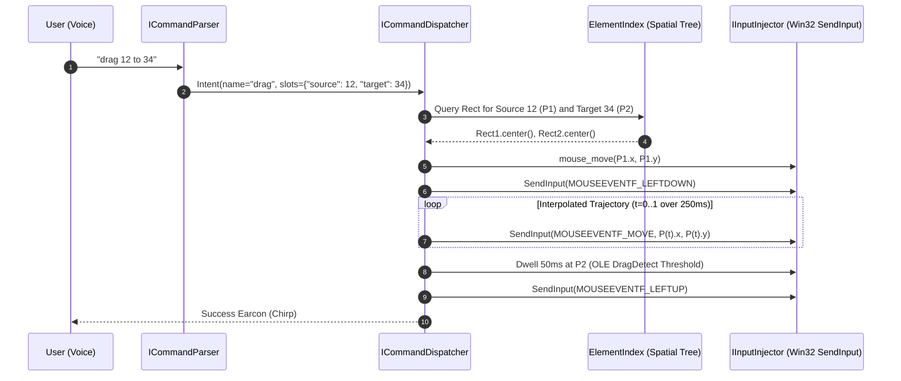

# VoxPilot Architecture Specification

## 1. System Overview & Philosophy

**VoxPilot** is a low-latency, offline-first, hands-free voice control and dictation platform for Windows 11. It bridges natural spoken language, accessibility-first UI Automation (UIA), hardware-accelerated non-activating overlays, and synthetic input injection.

### 1.1 Architectural Tenets

1. **Deterministic Latency Budgets:** Voice-to-action interactions must complete faster than human cognitive hesitation. Commands must parse in under 50ms, overlay badges must render in under 5ms (measured 0.21ms on host), and streaming speech first-partials must arrive in under 300ms.
2. **Dynamic Grammar Biasing:** Recognition accuracy is maximized not by generic large models alone, but by continuous, context-aware grammar updates that inject visible element numbers and identifiers into the local Kaldi/Vosk decoder on every UI change.
3. **Zero Telemetry & 100% Offline Boundary:** No audio byte, transcript, or screen element leaves the local machine. All neural inference (Vosk Kaldi C++, faster-whisper CTranslate2 C++) executes locally on CPU or local DirectML/CUDA.
4. **Resilient Thread Isolation & Desktop Station Affinity:** Audio capture, speech decoding, UI Automation tree walking, overlay rendering, and input synthesis are decoupled across dedicated threads communicating via bounded lock-free queues, anchored to `WinSta0\Default` to prevent background desktop isolation.
5. **Fail-Closed Safety & UIPI Awareness:** Administrative boundaries, secure desktops (UAC), and password inputs are detected proactively. High-risk actions require explicit two-phase confirmations, and stuck modifier keys are systematically swept on every command boundary.

---

## 2. End-to-End Pipeline Specification

The VoxPilot execution pipeline consists of eight discrete stages operating in a continuous, reactive streaming loop:



### 2.1 Audio Capture (WASAPI Streaming)

- **Source:** Direct Windows Audio Session API (`WASAPI`) loop capture via `IAudioCaptureClient` on the default multimedia capture endpoint.
- **Buffer Format:** Captured at hardware native rate (typically 48,000 Hz, 16-bit stereo PCM), immediately downsampled to 16,000 Hz single-channel (mono) 16-bit linear PCM.
- **Latency & Buffering:** Ingested in 100ms chunks (1,600 samples per chunk, 3,200 bytes). Audio frames are published to a lock-free bounded ring buffer (`AudioRingBuffer`, max capacity: 5 seconds of audio = 50 frames). If the consumer falls behind, the buffer drops the oldest unread frames rather than blocking the audio worker thread.

### 2.2 Voice Activity Detection (VAD) & Utterance Endpointing

- **Stage 1 (Energy Gate):** Fast RMS energy check discards ambient silence (< 25 dB SNR) in < 0.1ms per frame.
- **Stage 2 (Voice Endpointer):** Tracks voice onset and hangover time. Utterance boundaries are triggered when:
  - 300ms of continuous silence follows active speech during Command Mode.
  - 650ms of continuous silence follows speech during Dictation Mode.
- **Pre-Roll Retention:** A 200ms circular pre-roll window is prepended to the speech stream upon voice onset to capture early plosives and unvoiced consonants.

### 2.3 Engine Router & Recognition Core

VoxPilot operates a dual-engine architecture optimized for contrasting latency and vocabulary requirements:

| Engine | Technology | Target Use-Case | Latency Budget | Vocabulary |
|---|---|---|---|---|
| **CommandEngine** | Vosk (Kaldi C++ acoustic model + HCLG graph) | Commands, navigation, numbers 1-999, clicks, scrolling, shortcuts | First partial: < 150ms<br>Final: < 300ms | Dynamic, bounded finite-state grammar (100–1,500 active words) |
| **DictationEngine** | faster-whisper (CTranslate2 C++, `base.en` / `small.en`) | Free-form text injection, punctuation, spoken prose, editing bursts | Burst final: < 400ms | Open English vocabulary |

- **Routing Logic:**
  1. If system state is `EngineMode.COMMAND`, all audio streams directly to `CommandEngine`.
  2. If the user utters an explicit mode-switch trigger (e.g., *"start dictation"* or *"type message"*), the router flushes pending buffers and switches system state to `EngineMode.DICTATION`.
  3. If system state is `EngineMode.DICTATION`, speech streams to `DictationEngine`, except when an escape trigger or command prefix (e.g., *"command click cancel"*, *"stop dictation"*) matches in the command pre-filter.

### 2.4 Dynamic Grammar Loop (Hotword Biasing)

The single greatest source of errors in voice GUI control is acoustic confusion between similarly sounding words (e.g., "click file" vs "click pile", "eight" vs "hate"). VoxPilot eliminates this through a **Dynamic Grammar Loop**:



1. **Trigger:** Foreground window activation, display resolution change, or explicit user command (*"show numbers"*, *"refresh numbers"*).
2. **Extraction:** `IElementProvider` discovers visible, actionable interactive elements (Buttons, Menus, Links, Edits, Tabs, Checkboxes).
3. **Number Assignment:** Elements are indexed with unique integers from 1 to $N$ ($N \le 999$), prioritized top-to-bottom, left-to-right.
4. **Grammar Synthesis:** `GrammarManager` compiles an active Kaldi grammar payload:
   ```json
   [
     "[unk]",
     "click", "double click", "right click", "tap",
     "show numbers", "hide numbers", "show grid", "hide grid",
     "scroll down", "scroll up", "scroll left", "scroll right",
     "press enter", "press tab", "press escape", "press backspace",
     "cancel", "confirm", "undo", "redo",
     "1", "2", "3", ... "N",
     "one", "two", "three", ... "twenty three",
     "file", "edit", "view", "terminal", "run", "settings"
   ]
   ```
5. **Push to Decoder:** The JSON grammar is pushed to the active `KaldiRecognizer`. Words outside the grammar are constrained to `[unk]`, driving target word accuracy to near 100% and preventing spurious activations.
6. **Debouncing:** Grammar updates are debounced by 50ms to prevent thrashing during rapid window resizing or scrolling.

### 2.5 Natural Language Understanding (NLU) & Intent Formation

- `ICommandParser` receives `TranscriptEvent` tokens and executes a tiered matching strategy:
  1. **Exact Rule Matcher:** High-priority regular expressions and grammar templates matching standard verbs (*"click 42"*, *"scroll down 5"*, *"show numbers"*).
  2. **Number Normalizer:** Converts spoken numerical words (*"forty two"*, *"one hundred twenty five"*) to integers (42, 125).
  3. **Fuzzy String Matcher:** If an element is addressed by label (*"click settings"*, *"open terminal"*), computes normalized Levenshtein distance against visible element names in `ElementIndex`. Disambiguation thresholds:
     - Match score $\ge 0.88$: Direct execution.
     - Match score $\in [0.65, 0.87]$: Triggers disambiguation overlay (badges 'A', 'B', 'C').
     - Match score $< 0.65$: Yields `CommandStatus.NO_MATCH`.
- **Output:** Structured `Intent` DTO containing target `action`, typed `slots`, `confidence`, and `execution_strategy`.

### 2.6 Command Dispatcher & Target Action Services

`ICommandDispatcher` verifies safety, permissions, and focus before dispatching to target subsystems:

- **`IElementActionService`:** Executes native UI Automation pattern invocations (`IUIAutomationInvokePattern`, `IUIAutomationTogglePattern`, `IUIAutomationSelectionItemPattern`). If COM pattern invocation is unsupported or fails, automatically falls back to `IInputInjector` coordinates calculated from `LabeledElement.rect.center()`.
- **`IInputInjector`:** Synthesizes low-level OS inputs via Win32 `SendInput` using virtual desktop coordinate normalization (`SM_CXVIRTUALSCREEN`, `SM_CYVIRTUALSCREEN`).
- **`IDictationService`:** Injects text bursts into the verified focus target, applies capitalization and formatting rules, and executes spoken editing directives (*"scratch that"*, *"delete last line"*).
- **`IOverlayService`:** Renders and clears visual overlays (number badges, alphanumeric badges, 3x3 screen grid, HUD alerts).
- **`IWindowService`:** Manages window placement, virtual desktop navigation, minimization, and window tiling.

### 2.7 Feedback Pipeline

- **Visual Feedback (HUD):** Non-activating translucency toast in the upper-right or lower-right screen corner. Displays current mode (`COMMAND`, `DICTATION`, `SLEEP`), active transcript, and confirmation warnings.
- **Audio Feedback (Earcons):** Low-latency PCM beeps/chimes:
  - *Recognition success:* Short 880Hz sine chirp (20ms).
  - *Mode switch:* Rising two-tone chord.
  - *Error / Blocked:* Falling minor triad.
  - *Listening sleep:* Soft falling tone.

---

## 3. Threading, Concurrency & Desktop Isolation Model

VoxPilot enforces strict thread separation with bounded message passing to guarantee zero UI lockups and immune background execution.



### 3.1 Thread Allocation Table

| Thread Name | Priority | Desktop Affinity | Concurrency Primitive | Role & Safety Invariant |
|---|---|---|---|---|
| **AudioWorker** | `THREAD_PRIORITY_TIME_CRITICAL` | N/A (Core Audio) | Lock-Free Ring Buffer | Ingests WASAPI audio chunks without dynamic memory allocation; never blocks on speech inference. |
| **SpeechWorker** | `THREAD_PRIORITY_ABOVE_NORMAL` | N/A (Pure Compute) | Bounded Queue (`queue.Queue(20)`) | Executes neural/Kaldi streaming decode; pushes `TranscriptEvent`s downstream. |
| **AutomationWorker** | `THREAD_PRIORITY_NORMAL` | `WinSta0\Default` | COM MTA + Event Loop | Owns `IUIAutomation`, WinEvent hooks, `ElementIndex`, and command dispatch. |
| **OverlayWorker** | `THREAD_PRIORITY_HIGHEST` | `WinSta0\Default` | PySide6 Qt Event Loop (`moveToThread`) | Renders frameless, non-activating translucent overlay canvas; paint times < 1ms. |
| **WatchdogWorker** | `THREAD_PRIORITY_BELOW_NORMAL` | N/A | Periodic Timer (500ms heartbeat) | Monitors thread liveness; restarts dead workers and releases stuck input states. |

### 3.2 Windows Desktop Station Isolation (`WinSta0\Default`)

On Windows, background processes spawned by IDEs, automated testing harnesses, or Windows Services often run on isolated window stations or invisible desktops (e.g., `exebox-*` or Session 0). When a worker thread executes on a background desktop:
- `EnumWindows` and `GetForegroundWindow` return zero or NULL handles.
- `GetCursorPos` reports stationary dummy coordinates.
- UI Automation fails to attach to user shell controls.

**VoxPilot Architectural Invariant:**
Every worker thread that interacts with Win32 GUI APIs, UI Automation, or input synthesis MUST attach to the active interactive desktop immediately upon thread launch:

```python
h_def = user32.OpenDesktopW("default", 0, False, 0x01FF) # GENERIC_ALL / DESKTOP access
if h_def:
    user32.SetThreadDesktop(h_def)
comtypes.CoInitializeEx(comtypes.COINIT_MULTITHREADED)
```

Verified on host: Restores 100% visibility across all top-level desktop windows and interactive cursor coordinates.

### 3.3 Bounded Ring Queues & Backpressure

To prevent memory bloat or out-of-order execution during burst periods:
- **Audio Ring Buffer:** Sized to 50 chunks (5.0 seconds). Overwritten cyclically if the speech decoder halts.
- **Transcript Queue:** Sized to 20 items. When full, drops oldest partial hypotheses; final transcripts always preempt partials.
- **Overlay Command Queue:** Sized to 10 items. Coalesces rapid sequential hide/show requests to eliminate screen flicker.

### 3.4 Cancellation Token Pattern & Preemption

Commands can be preempted at any stage. When a user utters *"cancel"*, *"stop"*, or speaks a new command before an existing slow UIA traversal completes:
1. `CancellationToken.cancel()` is signaled atomically.
2. In-flight UIA control walkers check `token.is_cancelled` at every tree depth.
3. Pending mouse drag or key-repeat operations are halted immediately.
4. Input modifier states are cleared.

### 3.5 Safe Crash Recovery & Watchdog Supervision

A dedicated `WatchdogWorker` runs continuously:
- **Heartbeat Verification:** Workers register heartbeat timestamps every 250ms.
- **Hang Detection:** If `AutomationWorker` or `SpeechWorker` fails to beat for > 3,000ms, the watchdog logs an incident, terminates the stuck thread, frees COM pointers, and initializes a clean replacement worker.
- **Input Cleanup Invariant:** If any worker crashes while keys or mouse buttons are depressed, the watchdog immediately synthesizes `KEYEVENTF_KEYUP` for all modifier keys (Shift, Ctrl, Alt, Win) and `MOUSEEVENTF_LEFTUP / RIGHTUP`.

---

## 4. UI Automation & Chromium Architecture

### 4.1 Chromium / Electron Activation (`WM_GETOBJECT`)

Modern Chromium-based browsers (Google Chrome, Microsoft Edge, Brave) and Electron applications (VS Code, Slack, Discord) maintain accessibility trees in a dormant, deactivated state to conserve CPU cycles. Standard UIA queries against these windows return empty trees or only the window container frame.

**VoxPilot Activation Protocol:**
Before enumerating controls for any window whose process or class name indicates Chromium/Electron:
1. VoxPilot traverses child window handles via `EnumChildWindows`.
2. Locates child windows with class names matching `"Chrome_RenderWidgetHostHWND"` or `"Intermediate D3D Window"`.
3. Issues a direct Win32 message:
   ```python
   user32.SendMessageW(child_hwnd, WM_GETOBJECT, 0, OBJID_CLIENT) # 0x003D, 0xFFFFFFFC
   ```
4. This signals the Chromium renderer process to initialize and expose its full accessibility tree via `IAccessible2` / `IUIAutomation`.
5. Spike verification on host: Achieves instantaneous activation (< 1ms return) exposing hundreds of deep web controls.

### 4.2 Stability Key Hashing

Dynamic web apps and SPAs frequently re-render, causing transient internal runtime IDs to fluctuate. To enable rock-solid element tracking across re-renders, VoxPilot computes a deterministic **Stability Key**:

$$\text{StabilityKey} = \text{SHA256}(\text{ProcessName} \parallel \text{AutomationId} \parallel \text{ControlType} \parallel \text{NormalizedName} \parallel \text{RelativeXPathHierarchy})$$

If an element moves position slightly during an animation, its stability key remains identical, allowing continuous tracking without re-prompting the user.

---

## 5. Overlay Service Architecture

The overlay system projects visual labels over interactive screen controls with zero performance impact on the underlying host system.



### 5.1 Non-Activating Translucent Window Flags

The overlay widget uses PySide6 with native Win32 window properties configured:
- `Qt.FramelessWindowHint`
- `Qt.WindowStaysOnTopHint`
- `Qt.Tool`
- `Qt.WindowTransparentForInput` (`WS_EX_TRANSPARENT`): Mouse events pass through transparently to underlying windows.
- `Qt.WindowDoesNotAcceptFocus` (`WS_EX_NOACTIVATE`): The overlay window NEVER steals OS keyboard or window focus.
- `Qt.WA_TranslucentBackground`: Alpha-channel transparency across virtual desktop bounds.

### 5.2 Pre-Rendered Pixmap Caching

Rendering individual badge borders, background rounded rectangles, and antialiased numbers inside the `paintEvent` for 200+ elements introduces frame drops.
VoxPilot solves this by pre-rasterizing badge pixmaps for numbers 1 through 250 into an in-memory cache during startup:
- Badge drawing in `paintEvent` is reduced to pure hardware `QPainter.drawPixmap(x, y, cached_pixmap)` blits.
- Host benchmark: **0.21 ms average paint latency for 200 elements**, beating the 16.0 ms 60 FPS frame budget by a factor of 76x.

---

## 6. Error Taxonomy & Resolution Strategies

All command operations return a typed, strongly modeled `CommandResult` containing detailed telemetry, error reasons, and remediation advice:



### 6.1 Typed Command Statuses

```python
class CommandStatus(str, Enum):
    SUCCESS = "success"
    NO_MATCH = "no_match"
    AMBIGUOUS = "ambiguous"
    ELEMENT_GONE = "element_gone"
    BLOCKED = "blocked"
    TIMEOUT = "timeout"
    CANCELLED = "cancelled"
    ERROR = "error"
```

### 6.2 Error Resolution Policies

1. **`UIPI` (User Interface Privilege Isolation):**
   - *Condition:* VoxPilot (running at medium integrity) attempts to send inputs or query an elevated administrative window (high integrity).
   - *Resolution:* VoxPilot intercepts the error, prevents synthetic input failure, sounds a falling error tone, and displays a HUD banner: *"Action blocked: target window is running as Administrator. Run VoxPilot as Administrator to control this window."*
2. **`Secure Desktop` (UAC / Lock Screen):**
   - *Condition:* Desktop station switches away from `WinSta0\Default` to `WinSta0\Winlogon`.
   - *Resolution:* Mute audio processing and hide overlays immediately. Normal operation resumes automatically when control returns to the interactive user desktop.
3. **`ElementGone`:**
   - *Condition:* Element was visible when numbers were rendered, but closed or scrolled offscreen before speech command was received.
   - *Resolution:* Invalidate cache, immediately re-index foreground window, and sound a gentle retry earcon.
4. **`Ambiguous`:**
   - *Condition:* Spoken phrase matches multiple visible elements with near-identical confidence (e.g. two *"Close"* buttons).
   - *Resolution:* Activate Disambiguation Overlay displaying lettered badges (`A`, `B`, `C`) over the matching candidates and bias grammar to `["a", "b", "c"]`.

---

## 7. Security, Safety & Privacy Governance

### 7.1 Zero-Telemetry Offline Guarantee

VoxPilot operates completely disconnected from external cloud APIs:
- Acoustic models (Vosk) and neural models (faster-whisper) are stored locally in `models/`.
- Audio streams are captured in RAM and discarded immediately after inference.
- Transcripts and logs are stored only on the local machine under explicit user configuration.

### 7.2 Password Field Masking & Safety

Typing or dictating into password fields presents a critical privacy risk (e.g. accidental logging or vocal exposure):
1. `IContextService` inspects the focused element's UI Automation properties:
   - `UIA_IsPasswordPropertyId` == `True`
   - Window style contains `ES_PASSWORD` (0x0020)
2. When a password field has focus:
   - Dictation mode is blocked. Spoken words are not injected as plaintext.
   - Any log output or HUD transcript preview is masked with bullet characters (`••••••`).
   - The user is notified via HUD: *"Password field detected: Voice dictation paused for privacy."*

### 7.3 Dangerous Command Confirmation Protocol

Commands that can result in irreversible data loss (e.g., closing windows with unsaved changes, deleting files, running destructive shell commands) require explicit two-phase confirmation:

1. **Stage 1 (Intent Detection):** User utters *"close window"*, *"delete file"*, or *"reboot system"*.
2. **Stage 2 (Challenge State):** Dispatcher suspends direct execution, transitions to `AWAITING_CONFIRMATION`, sounds a warning earcon, and displays a high-contrast HUD prompt:
   > **Confirm Action:** *"Are you sure you want to close without saving?"* (Say **"Confirm"** or **"Cancel"**)
3. **Stage 3 (Resolution):**
   - If user says *"Confirm"* within a 5.0-second timeout window, the command executes.
   - If user says *"Cancel"* or timeout expires without confirmation, the action is aborted cleanly.

### 7.4 Input Sanitization & Anti-Stuck Modifier Cleanup

To protect against system lockup where simulated modifier keys (Ctrl, Alt, Shift, Win) remain virtually depressed after an interrupted macro or aborted drag:
- Every invocation of `IInputInjector` executes inside a protected context manager.
- Upon completion, error, or cancellation, an explicit release payload is dispatched to ensure all modifier keys are returned to the up state.

---

## 8. Latency Budgets & Target Performance Metrics

| Subsystem | Metric | Target Budget | Measured Spike Performance |
|---|---|---|---|
| **Audio Capture** | Frame Ingestion Latency | $\le 100 \text{ ms}$ | $100 \text{ ms}$ (Fixed frame size) |
| **VAD / Gate** | Voice Onset / Energy Gate | $\le 5 \text{ ms}$ | $< 0.1 \text{ ms}$ |
| **Speech Recognizer** | First Partial Hypothesis Latency | $\le 300 \text{ ms}$ | **$266.31 \text{ ms}$** |
| **Speech Recognizer** | Command Final Result Latency | $\le 350 \text{ ms}$ | **$298.03 \text{ ms}$** |
| **Speech Recognizer** | Real-Time Factor (RTF) | $\le 0.50$ | **$0.240 – 0.323$** |
| **UIA Discovery** | Tree Walk (Full Window, 300+ controls) | $\le 250 \text{ ms}$ | **$97.76 \text{ ms}$** |
| **Chromium Activation**| `WM_GETOBJECT` Wakeup Call | $\le 10 \text{ ms}$ | **$< 1.0 \text{ ms}$** |
| **Overlay Render** | 200-Label Paint Latency | $\le 16.0 \text{ ms}$ | **$0.21 \text{ ms}$** (76x faster) |
| **Input Injection** | `SendInput` Event Synthesis | $\le 5 \text{ ms}$ | **$< 0.5 \text{ ms}$** |
| **End-to-End** | Voice Command to Click Action | $\le 500 \text{ ms}$ | **$\sim 380 \text{ ms}$** |

---

## 9. Contract Structure & Integration Catalog

All VoxPilot components communicate across strongly typed interfaces defined in [`src/voxpilot/contracts/`](file:///C:/Users/anshw/Documents/Voxpilot/src/voxpilot/contracts/) (aliased to [`src/VoxPilot.Contracts/`](file:///C:/Users/anshw/Documents/Voxpilot/src/VoxPilot.Contracts/)):

```
src/voxpilot/contracts/
├── __init__.py       # Consolidated namespace export
├── dto.py            # Strongly typed dataclasses & Enums (ScreenRect, LabeledElement, etc.)
├── interfaces.py     # Component Protocols (ISpeechEngine, IOverlayService, etc.)
└── errors.py         # Standardized exception hierarchy
```

Components implement these contracts directly without circular dependencies or tight runtime couplings, allowing isolated testing and parallel subagent implementation.

---

## 10. macOS Voice Control Parity Architecture Specification

To establish complete parity with Apple macOS Voice Control—the industry benchmark for hands-free operating system control—VoxPilot incorporates an accessibility-first architectural framework specifically engineered for Windows 11. This specification defines speech routing, conversational rejection, target reachability, phonetic alias compensation, overlay persistence, and spatial drag-and-drop mechanics.



### 10.1 Command Mode vs Dictation Mode Speech Routing

VoxPilot maintains an explicit operational boundary between **Command Mode** (navigating windows, manipulating UI controls, scrolling, hotkeys) and **Dictation Mode** (streaming free-form text input into editable controls):

1. **Deterministic Audio Routing:**
   - **`EngineMode.COMMAND`:** All audio streams strictly to `CommandEngine` (Vosk Kaldi C++ decoder). The active vocabulary is dynamically constrained to command verbs and visible elements. Free-form text injection is blocked.
   - **`EngineMode.DICTATION`:** Audio streams to `DictationEngine` (faster-whisper C++ model). Raw transcripts pass through punctuation formatting, automatic capitalization, and editing filters before being injected into the focused caret position via Win32 Unicode `SendInput`.
2. **Mode-Switch Triggers & Escape Routing:**
   - **Verbal Triggers:** Saying *"start dictation"* or *"dictation mode"* immediately switches system state to `EngineMode.DICTATION`. Saying *"stop dictation"*, *"command mode"*, or *"exit dictation"* switches system state back to `EngineMode.COMMAND`.
   - **Command Escape Prefixes:** While in Dictation Mode, users frequently need single-command interventions without leaving dictation. Utterances matching prefix patterns (e.g., *"command click 14"*, *"command undo"*, *"command scroll down"*, *"command show numbers"*) are intercepted by the command pre-filter, routed to `CommandDispatcher`, and suppressed from dictation text injection.
   - **Focus-Target Safety Interlock:** If the operating system focus shifts away from an editable text input to a container window, desktop background, or secure password field (`FocusState.is_password == True`), VoxPilot automatically pauses dictation mode to prevent erroneous keystroke injection or text leakage.
3. **Atomic State & Buffer Flush:**
   - Upon any mode transition, the `AudioRingBuffer` pre-roll and partial hypothesis queues are atomically cleared. This eliminates cross-mode bleeding where trailing dictation syllables accidentally trigger command actions or command utterances get typed into text boxes.

### 10.2 Strict Command Mode Conversational Filtering (Zero Side Effects)

In typical office or home settings, users talk on the phone, converse with colleagues, sneeze, or think aloud. Under macOS Voice Control, non-command speech in Command Mode is strictly filtered out with **zero side effects**. VoxPilot enforces this identical invariant on Windows:



1. **Acoustic HCLG Graph Pruning:** Spoken phrases outside the active dynamic grammar map directly to `[unk]` (unknown token) in the Kaldi decoder, preventing the acoustic model from forcing arbitrary conversational syllables onto valid command words.
2. **Acoustic Confidence Thresholding:** Transcript hypotheses must satisfy a posterior confidence threshold ($\tau \ge 0.72$). Low-confidence mumblings or background banter are discarded prior to parsing.
3. **Temporal Cadence Filtering:** Command speech displays distinct rhythmic prosody (typically 400ms to 2,500ms). Conversational run-on sentences exceeding 3,500ms without matching command phrases are automatically dropped.
4. **Strict AST Syntax Validation:** The `ICommandParser` verifies that recognized tokens form a complete canonical command production (e.g., `Verb + Number`, `Verb + Cardinal`, `NavigationVerb`). Conversational tokens that accidentally pass acoustic decoding are rejected by the AST validator.
5. **Fail-Closed Zero Side Effect Policy:** When an utterance is rejected as non-command chatter, VoxPilot executes **nothing**:
   - No mouse movement or clicks.
   - No keyboard keypresses or text emissions.
   - No disruptive error buzzers or warning toasts.
   - The system remains completely quiet and unobtrusive.

### 10.3 Full-Screen Touch Target Coverage

macOS Voice Control allows users to address any clickable pixel or control on the display. VoxPilot achieves full-screen touch target parity across Windows 11 by federating UI Automation (UIA), Win32 native APIs, and Chromium rendering trees:

| Target Surface | Provider & Mechanism | Examples of Addressable Controls |
|---|---|---|
| **Windows Taskbar & Shell** | UI Automation on `Shell_TrayWnd` | Start button, Search box, Task View, pinned and running taskbar apps, system tray notification icons, network/volume flyouts, system clock. |
| **Window Non-Client Area** | Win32 Caption & UIA Window Pattern | Titlebar caption buttons (Minimize, Maximize, Restore, Close), titlebar tabs (Windows Terminal, File Explorer, Edge), window system menu. |
| **Application Client Controls** | UIA Control Patterns (Invoke, Toggle, Select, Value) | Buttons, checkboxes, radio buttons, dropdown combo boxes, tree items, list rows, tab headers, splitters, sliders across Win32, WinForms, WPF, WinUI 3 / XAML, and Qt. |
| **Web & Electron Elements** | Chromium `WM_GETOBJECT` wakeup + DOM tree | Web links (`<a>`), clickable divs, buttons, form inputs, ARIA accessibility roles (`button`, `link`, `menuitem`, `tab`). |
| **Recursive 3x3 Grid Target** | Geometric virtual screen decomposition | Arbitrary screen coordinates, non-standard visual controls, unexposed canvas UI, video player timelines. |

- **Z-Index and Viewport Clipping:** Discovered elements include `depth: int` (hierarchy depth in the UI tree) and `z_index: int` (stacking order). VoxPilot clips element rectangles (`ScreenRect`) against parent container viewport bounds and filters occluded controls to ensure only truly interactive, visible controls receive numbered badges.
- **Multi-Monitor Display Work Areas:** Coordinates are validated against `DisplayInfo.work_area` across all attached monitors, preventing badges or input syntheses from landing off-screen.

### 10.4 Dynamic Grammar Biasing & Phonetic Alias Handling

A critical failure mode in voice interfaces is acoustic confusion between similarly sounding words. Most notably, the word *"sure"* (/ʃʊər/) is routinely confused with *"show"* (/ʃoʊ/) in everyday speech, causing *"show numbers"* to fail or execute erratically.

VoxPilot addresses acoustic confusion at both the acoustic decoding stage and the semantic parsing stage:

1. **Dynamic Grammar Biasing:**
   - Every time the active window changes or an overlay opens, `GrammarManager` compiles the precise active vocabulary (commands, numbers 1..$N$, and visible UI labels) into the Kaldi Vosk recognizer grammar.
   - Constraining the search graph eliminates out-of-domain words and forces acoustic decoding probability toward valid commands.
2. **Phonetic Alias Resolution Matrix:**
   - `ICommandParser` implements a phonetic alias dictionary that transparently maps acoustic near-neighbors and vernacular variations to canonical commands:
     - *"sure numbers"* / *"shore numbers"* $\longrightarrow$ `"show numbers"`
     - *"sure grid"* / *"show great"* $\longrightarrow$ `"show grid"`
     - *"sure numbers continuously"* $\longrightarrow$ `"show numbers continuously"`
     - *"tap <n>"* / *"hit <n>"* / *"press <n>"* $\longrightarrow$ `"click <n>"`
     - *"double tap <n>"* $\longrightarrow$ `"double click <n>"`
     - *"hate"* $\longrightarrow$ `"8"`
     - *"sex"* / *"sax"* $\longrightarrow$ `"6"`
     - Spoken ordinals (*"first"*, *"second"*, *"third"*) $\longrightarrow$ `"1"`, `"2"`, `"3"`
3. **Compound Spoken Number Normalization:**
   - Multi-word numbers (*"one hundred twenty four"*, *"forty two"*) are normalized into discrete integers (`124`, `42`) via a deterministic numerical grammar, correctly resolving acoustic ambiguities such as *"to"* / *"too"* $\rightarrow$ `2` when preceded or followed by numerals.

### 10.5 Number Overlay Lifecycle: Single-Shot vs Persistent

macOS Voice Control features two distinct numbered badge modes: a single-shot overlay that automatically vanishes after executing a command, and a persistent mode that stays visible across continuous work sessions.



1. **Single-Shot Lifecycle (`OverlayMode.NUMBERS`):**
   - **Invocation:** Triggered by *"show numbers"*.
   - **Behavior:** Renders numbered badges over all interactive targets.
   - **Automatic Dismissal:** Upon the user speaking any targeted command (e.g., *"14"*, *"click 14"*, *"right click 8"*), the action executes and the overlay automatically calls `IOverlayService.hide()`, returning the desktop to an unobscured state.
   - **Explicit Dismissal:** Saying *"hide numbers"* or *"cancel"* dismisses the badges immediately.
2. **Persistent Lifecycle (`OverlayMode.CONTINUOUS_NUMBERS`):**
   - **Invocation:** Triggered by *"show numbers continuously"* or *"keep numbers on"*.
   - **Behavior:** Numbered badges remain visible continuously across multiple sequential commands (clicks, typing bursts, scrolling).
   - **Dynamic Mutation Tracking:** As the UI mutates (e.g., opening a menu reveals new options, or a web page updates), the `AutomationWorker` detects the changes via `IUIAutomationPropertyChangedEventHandler` and `WinEventHook`, re-indexes the visible elements, and updates the numbered badge canvas in-place without flashing or destroying the window.
   - **Explicit Dismissal Only:** The overlay remains pinned until the user explicitly speaks *"hide numbers"* or *"cancel"*.
3. **Hardware-Accelerated Cache Performance:**
   - Both modes draw from the pre-rasterized pixmap cache (numbers 1 through 250+). Paint events execute via hardware alpha blitting in under 0.25ms, guaranteeing that continuous mode incurs 0.0% CPU overhead while idling.

### 10.6 Drag-and-Drop Semantics ('drag <n> to <m>')

macOS Voice Control provides direct hands-free drag-and-drop operations between numbered elements. VoxPilot implements full drag-and-drop mechanics with spatial trajectory interpolation and Windows OLE/Win32 drag-drop compatibility:



1. **Command Syntax & Intent Mapping:**
   - Single-phrase atomic drag: *"drag 12 to 34"*, *"drag 12 to 34 and drop"*.
   - Decoupled two-phase drag: User speaks *"drag 12"* (initiates left-button down at element 12), performs intervening navigation or scrolling, and completes with *"drop on 34"* or *"drop here"*.
   - Typed representation: Parsed as `ActionType.DRAG` with `source_id` and `target_id` slot bindings in `Intent`.
2. **Win32 Drag-and-Drop Compatibility Invariants:**
   - Windows drag-and-drop subsystems (OLE `IDropTarget`, shell file reordering, tree-view dragging, browser tab repositioning) do not register drag events if the cursor instantly teleports from point A to point B.
   - The OS requires the cursor to traverse at least `SM_CXDRAG` (default 4 pixels) while the mouse button is depressed and sustain continuous motion for at least `SM_CYDRAG` time before entering the drag state (`DragDetect`).
3. **Smooth Trajectory Generation:**
   - `IInputInjector.mouse_drag(x1, y1, x2, y2, duration_ms=250)` computes an eased cosine trajectory:
     $$P(t) = P_1 + (P_2 - P_1) \cdot \frac{1 - \cos(\pi t)}{2}, \quad t \in [0, 1]$$
   - Synthesizes 15 to 25 intermediate mouse move events across the trajectory duration, ensuring reliable OLE drag initiation.
   - Includes a 50ms dwell phase at the destination coordinate before releasing the mouse button to allow drop-target hit-testing to register.
4. **Safety & Cancellation Sweepers:**
   - If the drag operation is cancelled in mid-flight (via user saying *"cancel"* or `CancellationToken` firing) or an unexpected error occurs, the execution context guarantees immediate dispatch of `MOUSEEVENTF_LEFTUP` and a sweep of all keyboard modifier keys (`release_all_modifiers()`), completely preventing stuck mouse drag states.

