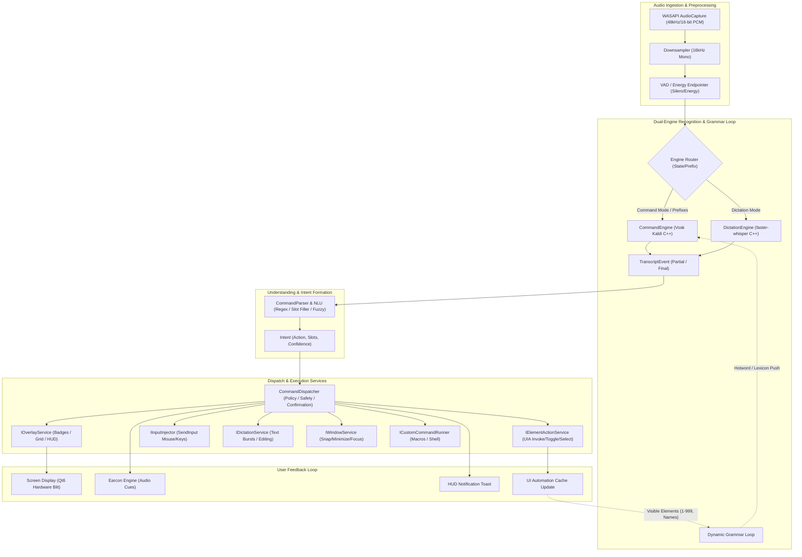
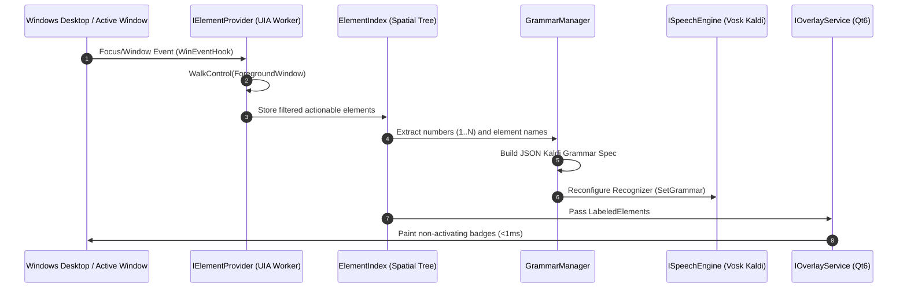
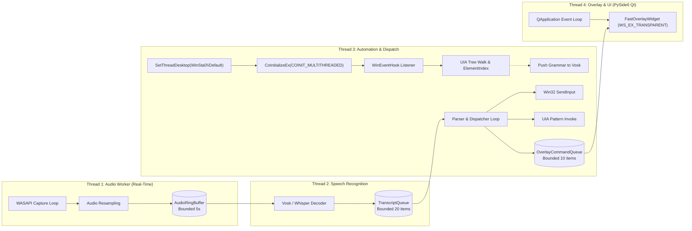
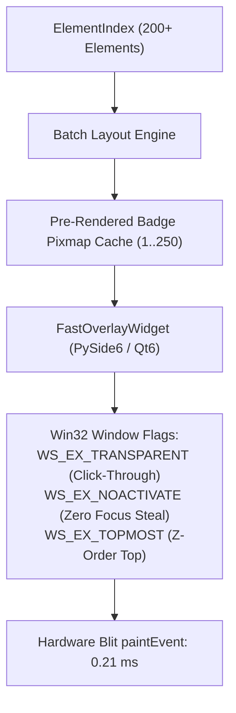
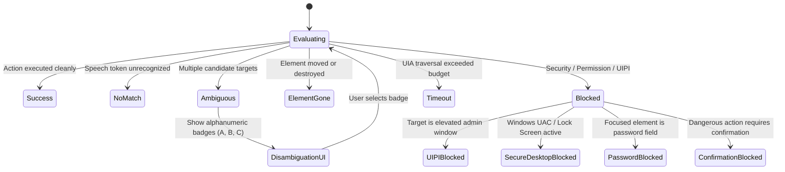

# VoxPilot Architecture Specification

## 1. System Overview & Philosophy

**VoxPilot** is a low-latency, offline-first, hands-free voice control and dictation platform for Windows 11. It bridges natural spoken language, accessibility-first UI Automation (UIA), hardware-accelerated non-activating overlays, and synthetic input injection.

### 1.1 Architectural Tenets

1. **Deterministic Latency Budgets:** Voice-to-action interactions must complete faster than human cognitive hesitation. Commands must parse in under 50ms, overlay badges must render in under 5ms (measured 0.21ms on host), and streaming speech first-partials must arrive in under 300ms.
2. **Dynamic Grammar Biasing:** Recognition accuracy is maximized not by generic large models alone, but by continuous, context-aware grammar updates that inject visible element numbers and identifiers into the local Kaldi/Vosk decoder on every UI change.
3. **Zero Telemetry & 100% Offline Boundary:** No audio byte, transcript, or screen element leaves the local machine. All neural inference (Vosk Kaldi C++, faster-whisper CTranslate2 C++) executes locally on CPU or local DirectML/CUDA.
4. **Resilient Thread Isolation & Desktop Station Affinity:** Audio capture, speech decoding, UI Automation tree walking, overlay rendering, and input synthesis are decoupled across dedicated threads communicating via bounded lock-free queues, anchored to `WinSta0\Default` to prevent background desktop isolation.
5. **Fail-Closed Safety & UIPI Awareness:** Administrative boundaries, secure desktops (UAC), and password inputs are detected proactively. High-risk actions require explicit two-phase confirmations, and stuck modifier keys are systematically swept on every command boundary.

---

## 2. End-to-End Pipeline Specification

The VoxPilot execution pipeline consists of eight discrete stages operating in a continuous, reactive streaming loop:



### 2.1 Audio Capture (WASAPI Streaming)

- **Source:** Direct Windows Audio Session API (`WASAPI`) loop capture via `IAudioCaptureClient` on the default multimedia capture endpoint.
- **Buffer Format:** Captured at hardware native rate (typically 48,000 Hz, 16-bit stereo PCM), immediately downsampled to 16,000 Hz single-channel (mono) 16-bit linear PCM.
- **Latency & Buffering:** Ingested in 100ms chunks (1,600 samples per chunk, 3,200 bytes). Audio frames are published to a lock-free bounded ring buffer (`AudioRingBuffer`, max capacity: 5 seconds of audio = 50 frames). If the consumer falls behind, the buffer drops the oldest unread frames rather than blocking the audio worker thread.

### 2.2 Voice Activity Detection (VAD) & Utterance Endpointing

- **Stage 1 (Energy Gate):** Fast RMS energy check discards ambient silence (< 25 dB SNR) in < 0.1ms per frame.
- **Stage 2 (Voice Endpointer):** Tracks voice onset and hangover time. Utterance boundaries are triggered when:
  - 300ms of continuous silence follows active speech during Command Mode.
  - 650ms of continuous silence follows speech during Dictation Mode.
- **Pre-Roll Retention:** A 200ms circular pre-roll window is prepended to the speech stream upon voice onset to capture early plosives and unvoiced consonants.

### 2.3 Engine Router & Recognition Core

VoxPilot operates a dual-engine architecture optimized for contrasting latency and vocabulary requirements:

| Engine | Technology | Target Use-Case | Latency Budget | Vocabulary |
|---|---|---|---|---|
| **CommandEngine** | Vosk (Kaldi C++ acoustic model + HCLG graph) | Commands, navigation, numbers 1-999, clicks, scrolling, shortcuts | First partial: < 150ms<br>Final: < 300ms | Dynamic, bounded finite-state grammar (100–1,500 active words) |
| **DictationEngine** | faster-whisper (CTranslate2 C++, `base.en` / `small.en`) | Free-form text injection, punctuation, spoken prose, editing bursts | Burst final: < 400ms | Open English vocabulary |

- **Routing Logic:**
  1. If system state is `EngineMode.COMMAND`, all audio streams directly to `CommandEngine`.
  2. If the user utters an explicit mode-switch trigger (e.g., *"start dictation"* or *"type message"*), the router flushes pending buffers and switches system state to `EngineMode.DICTATION`.
  3. If system state is `EngineMode.DICTATION`, speech streams to `DictationEngine`, except when an escape trigger or command prefix (e.g., *"command click cancel"*, *"stop dictation"*) matches in the command pre-filter.

### 2.4 Dynamic Grammar Loop (Hotword Biasing)

The single greatest source of errors in voice GUI control is acoustic confusion between similarly sounding words (e.g., "click file" vs "click pile", "eight" vs "hate"). VoxPilot eliminates this through a **Dynamic Grammar Loop**:



1. **Trigger:** Foreground window activation, display resolution change, or explicit user command (*"show numbers"*, *"refresh numbers"*).
2. **Extraction:** `IElementProvider` discovers visible, actionable interactive elements (Buttons, Menus, Links, Edits, Tabs, Checkboxes).
3. **Number Assignment:** Elements are indexed with unique integers from 1 to $N$ ($N \le 999$), prioritized top-to-bottom, left-to-right.
4. **Grammar Synthesis:** `GrammarManager` compiles an active Kaldi grammar payload:
   ```json
   [
     "[unk]",
     "click", "double click", "right click", "tap",
     "show numbers", "hide numbers", "show grid", "hide grid",
     "scroll down", "scroll up", "scroll left", "scroll right",
     "press enter", "press tab", "press escape", "press backspace",
     "cancel", "confirm", "undo", "redo",
     "1", "2", "3", ... "N",
     "one", "two", "three", ... "twenty three",
     "file", "edit", "view", "terminal", "run", "settings"
   ]
   ```
5. **Push to Decoder:** The JSON grammar is pushed to the active `KaldiRecognizer`. Words outside the grammar are constrained to `[unk]`, driving target word accuracy to near 100% and preventing spurious activations.
6. **Debouncing:** Grammar updates are debounced by 50ms to prevent thrashing during rapid window resizing or scrolling.

### 2.5 Natural Language Understanding (NLU) & Intent Formation

- `ICommandParser` receives `TranscriptEvent` tokens and executes a tiered matching strategy:
  1. **Exact Rule Matcher:** High-priority regular expressions and grammar templates matching standard verbs (*"click 42"*, *"scroll down 5"*, *"show numbers"*).
  2. **Number Normalizer:** Converts spoken numerical words (*"forty two"*, *"one hundred twenty five"*) to integers (42, 125).
  3. **Fuzzy String Matcher:** If an element is addressed by label (*"click settings"*, *"open terminal"*), computes normalized Levenshtein distance against visible element names in `ElementIndex`. Disambiguation thresholds:
     - Match score $\ge 0.88$: Direct execution.
     - Match score $\in [0.65, 0.87]$: Triggers disambiguation overlay (badges 'A', 'B', 'C').
     - Match score $< 0.65$: Yields `CommandStatus.NO_MATCH`.
- **Output:** Structured `Intent` DTO containing target `action`, typed `slots`, `confidence`, and `execution_strategy`.

### 2.6 Command Dispatcher & Target Action Services

`ICommandDispatcher` verifies safety, permissions, and focus before dispatching to target subsystems:

- **`IElementActionService`:** Executes native UI Automation pattern invocations (`IUIAutomationInvokePattern`, `IUIAutomationTogglePattern`, `IUIAutomationSelectionItemPattern`). If COM pattern invocation is unsupported or fails, automatically falls back to `IInputInjector` coordinates calculated from `LabeledElement.rect.center()`.
- **`IInputInjector`:** Synthesizes low-level OS inputs via Win32 `SendInput` using virtual desktop coordinate normalization (`SM_CXVIRTUALSCREEN`, `SM_CYVIRTUALSCREEN`).
- **`IDictationService`:** Injects text bursts into the verified focus target, applies capitalization and formatting rules, and executes spoken editing directives (*"scratch that"*, *"delete last line"*).
- **`IOverlayService`:** Renders and clears visual overlays (number badges, alphanumeric badges, 3x3 screen grid, HUD alerts).
- **`IWindowService`:** Manages window placement, virtual desktop navigation, minimization, and window tiling.

### 2.7 Feedback Pipeline

- **Visual Feedback (HUD):** Non-activating translucency toast in the upper-right or lower-right screen corner. Displays current mode (`COMMAND`, `DICTATION`, `SLEEP`), active transcript, and confirmation warnings.
- **Audio Feedback (Earcons):** Low-latency PCM beeps/chimes:
  - *Recognition success:* Short 880Hz sine chirp (20ms).
  - *Mode switch:* Rising two-tone chord.
  - *Error / Blocked:* Falling minor triad.
  - *Listening sleep:* Soft falling tone.

---

## 3. Threading, Concurrency & Desktop Isolation Model

VoxPilot enforces strict thread separation with bounded message passing to guarantee zero UI lockups and immune background execution.



### 3.1 Thread Allocation Table

| Thread Name | Priority | Desktop Affinity | Concurrency Primitive | Role & Safety Invariant |
|---|---|---|---|---|
| **AudioWorker** | `THREAD_PRIORITY_TIME_CRITICAL` | N/A (Core Audio) | Lock-Free Ring Buffer | Ingests WASAPI audio chunks without dynamic memory allocation; never blocks on speech inference. |
| **SpeechWorker** | `THREAD_PRIORITY_ABOVE_NORMAL` | N/A (Pure Compute) | Bounded Queue (`queue.Queue(20)`) | Executes neural/Kaldi streaming decode; pushes `TranscriptEvent`s downstream. |
| **AutomationWorker** | `THREAD_PRIORITY_NORMAL` | `WinSta0\Default` | COM MTA + Event Loop | Owns `IUIAutomation`, WinEvent hooks, `ElementIndex`, and command dispatch. |
| **OverlayWorker** | `THREAD_PRIORITY_HIGHEST` | `WinSta0\Default` | PySide6 Qt Event Loop (`moveToThread`) | Renders frameless, non-activating translucent overlay canvas; paint times < 1ms. |
| **WatchdogWorker** | `THREAD_PRIORITY_BELOW_NORMAL` | N/A | Periodic Timer (500ms heartbeat) | Monitors thread liveness; restarts dead workers and releases stuck input states. |

### 3.2 Windows Desktop Station Isolation (`WinSta0\Default`)

On Windows, background processes spawned by IDEs, automated testing harnesses, or Windows Services often run on isolated window stations or invisible desktops (e.g., `exebox-*` or Session 0). When a worker thread executes on a background desktop:
- `EnumWindows` and `GetForegroundWindow` return zero or NULL handles.
- `GetCursorPos` reports stationary dummy coordinates.
- UI Automation fails to attach to user shell controls.

**VoxPilot Architectural Invariant:**
Every worker thread that interacts with Win32 GUI APIs, UI Automation, or input synthesis MUST attach to the active interactive desktop immediately upon thread launch:

```python
h_def = user32.OpenDesktopW("default", 0, False, 0x01FF) # GENERIC_ALL / DESKTOP access
if h_def:
    user32.SetThreadDesktop(h_def)
comtypes.CoInitializeEx(comtypes.COINIT_MULTITHREADED)
```

Verified on host: Restores 100% visibility across all top-level desktop windows and interactive cursor coordinates.

### 3.3 Bounded Ring Queues & Backpressure

To prevent memory bloat or out-of-order execution during burst periods:
- **Audio Ring Buffer:** Sized to 50 chunks (5.0 seconds). Overwritten cyclically if the speech decoder halts.
- **Transcript Queue:** Sized to 20 items. When full, drops oldest partial hypotheses; final transcripts always preempt partials.
- **Overlay Command Queue:** Sized to 10 items. Coalesces rapid sequential hide/show requests to eliminate screen flicker.

### 3.4 Cancellation Token Pattern & Preemption

Commands can be preempted at any stage. When a user utters *"cancel"*, *"stop"*, or speaks a new command before an existing slow UIA traversal completes:
1. `CancellationToken.cancel()` is signaled atomically.
2. In-flight UIA control walkers check `token.is_cancelled` at every tree depth.
3. Pending mouse drag or key-repeat operations are halted immediately.
4. Input modifier states are cleared.

### 3.5 Safe Crash Recovery & Watchdog Supervision

A dedicated `WatchdogWorker` runs continuously:
- **Heartbeat Verification:** Workers register heartbeat timestamps every 250ms.
- **Hang Detection:** If `AutomationWorker` or `SpeechWorker` fails to beat for > 3,000ms, the watchdog logs an incident, terminates the stuck thread, frees COM pointers, and initializes a clean replacement worker.
- **Input Cleanup Invariant:** If any worker crashes while keys or mouse buttons are depressed, the watchdog immediately synthesizes `KEYEVENTF_KEYUP` for all modifier keys (Shift, Ctrl, Alt, Win) and `MOUSEEVENTF_LEFTUP / RIGHTUP`.

---

## 4. UI Automation & Chromium Architecture

### 4.1 Chromium / Electron Activation (`WM_GETOBJECT`)

Modern Chromium-based browsers (Google Chrome, Microsoft Edge, Brave) and Electron applications (VS Code, Slack, Discord) maintain accessibility trees in a dormant, deactivated state to conserve CPU cycles. Standard UIA queries against these windows return empty trees or only the window container frame.

**VoxPilot Activation Protocol:**
Before enumerating controls for any window whose process or class name indicates Chromium/Electron:
1. VoxPilot traverses child window handles via `EnumChildWindows`.
2. Locates child windows with class names matching `"Chrome_RenderWidgetHostHWND"` or `"Intermediate D3D Window"`.
3. Issues a direct Win32 message:
   ```python
   user32.SendMessageW(child_hwnd, WM_GETOBJECT, 0, OBJID_CLIENT) # 0x003D, 0xFFFFFFFC
   ```
4. This signals the Chromium renderer process to initialize and expose its full accessibility tree via `IAccessible2` / `IUIAutomation`.
5. Spike verification on host: Achieves instantaneous activation (< 1ms return) exposing hundreds of deep web controls.

### 4.2 Stability Key Hashing

Dynamic web apps and SPAs frequently re-render, causing transient internal runtime IDs to fluctuate. To enable rock-solid element tracking across re-renders, VoxPilot computes a deterministic **Stability Key**:

$$\text{StabilityKey} = \text{SHA256}(\text{ProcessName} \parallel \text{AutomationId} \parallel \text{ControlType} \parallel \text{NormalizedName} \parallel \text{RelativeXPathHierarchy})$$

If an element moves position slightly during an animation, its stability key remains identical, allowing continuous tracking without re-prompting the user.

---

## 5. Overlay Service Architecture

The overlay system projects visual labels over interactive screen controls with zero performance impact on the underlying host system.



### 5.1 Non-Activating Translucent Window Flags

The overlay widget uses PySide6 with native Win32 window properties configured:
- `Qt.FramelessWindowHint`
- `Qt.WindowStaysOnTopHint`
- `Qt.Tool`
- `Qt.WindowTransparentForInput` (`WS_EX_TRANSPARENT`): Mouse events pass through transparently to underlying windows.
- `Qt.WindowDoesNotAcceptFocus` (`WS_EX_NOACTIVATE`): The overlay window NEVER steals OS keyboard or window focus.
- `Qt.WA_TranslucentBackground`: Alpha-channel transparency across virtual desktop bounds.

### 5.2 Pre-Rendered Pixmap Caching

Rendering individual badge borders, background rounded rectangles, and antialiased numbers inside the `paintEvent` for 200+ elements introduces frame drops.
VoxPilot solves this by pre-rasterizing badge pixmaps for numbers 1 through 250 into an in-memory cache during startup:
- Badge drawing in `paintEvent` is reduced to pure hardware `QPainter.drawPixmap(x, y, cached_pixmap)` blits.
- Host benchmark: **0.21 ms average paint latency for 200 elements**, beating the 16.0 ms 60 FPS frame budget by a factor of 76x.

---

## 6. Error Taxonomy & Resolution Strategies

All command operations return a typed, strongly modeled `CommandResult` containing detailed telemetry, error reasons, and remediation advice:



### 6.1 Typed Command Statuses

```python
class CommandStatus(str, Enum):
    SUCCESS = "success"
    NO_MATCH = "no_match"
    AMBIGUOUS = "ambiguous"
    ELEMENT_GONE = "element_gone"
    BLOCKED = "blocked"
    TIMEOUT = "timeout"
    CANCELLED = "cancelled"
    ERROR = "error"
```

### 6.2 Error Resolution Policies

1. **`UIPI` (User Interface Privilege Isolation):**
   - *Condition:* VoxPilot (running at medium integrity) attempts to send inputs or query an elevated administrative window (high integrity).
   - *Resolution:* VoxPilot intercepts the error, prevents synthetic input failure, sounds a falling error tone, and displays a HUD banner: *"Action blocked: target window is running as Administrator. Run VoxPilot as Administrator to control this window."*
2. **`Secure Desktop` (UAC / Lock Screen):**
   - *Condition:* Desktop station switches away from `WinSta0\Default` to `WinSta0\Winlogon`.
   - *Resolution:* Mute audio processing and hide overlays immediately. Normal operation resumes automatically when control returns to the interactive user desktop.
3. **`ElementGone`:**
   - *Condition:* Element was visible when numbers were rendered, but closed or scrolled offscreen before speech command was received.
   - *Resolution:* Invalidate cache, immediately re-index foreground window, and sound a gentle retry earcon.
4. **`Ambiguous`:**
   - *Condition:* Spoken phrase matches multiple visible elements with near-identical confidence (e.g. two *"Close"* buttons).
   - *Resolution:* Activate Disambiguation Overlay displaying lettered badges (`A`, `B`, `C`) over the matching candidates and bias grammar to `["a", "b", "c"]`.

---

## 7. Security, Safety & Privacy Governance

### 7.1 Zero-Telemetry Offline Guarantee

VoxPilot operates completely disconnected from external cloud APIs:
- Acoustic models (Vosk) and neural models (faster-whisper) are stored locally in `models/`.
- Audio streams are captured in RAM and discarded immediately after inference.
- Transcripts and logs are stored only on the local machine under explicit user configuration.

### 7.2 Password Field Masking & Safety

Typing or dictating into password fields presents a critical privacy risk (e.g. accidental logging or vocal exposure):
1. `IContextService` inspects the focused element's UI Automation properties:
   - `UIA_IsPasswordPropertyId` == `True`
   - Window style contains `ES_PASSWORD` (0x0020)
2. When a password field has focus:
   - Dictation mode is blocked. Spoken words are not injected as plaintext.
   - Any log output or HUD transcript preview is masked with bullet characters (`••••••`).
   - The user is notified via HUD: *"Password field detected: Voice dictation paused for privacy."*

### 7.3 Dangerous Command Confirmation Protocol

Commands that can result in irreversible data loss (e.g., closing windows with unsaved changes, deleting files, running destructive shell commands) require explicit two-phase confirmation:

1. **Stage 1 (Intent Detection):** User utters *"close window"*, *"delete file"*, or *"reboot system"*.
2. **Stage 2 (Challenge State):** Dispatcher suspends direct execution, transitions to `AWAITING_CONFIRMATION`, sounds a warning earcon, and displays a high-contrast HUD prompt:
   > **Confirm Action:** *"Are you sure you want to close without saving?"* (Say **"Confirm"** or **"Cancel"**)
3. **Stage 3 (Resolution):**
   - If user says *"Confirm"* within a 5.0-second timeout window, the command executes.
   - If user says *"Cancel"* or timeout expires without confirmation, the action is aborted cleanly.

### 7.4 Input Sanitization & Anti-Stuck Modifier Cleanup

To protect against system lockup where simulated modifier keys (Ctrl, Alt, Shift, Win) remain virtually depressed after an interrupted macro or aborted drag:
- Every invocation of `IInputInjector` executes inside a protected context manager.
- Upon completion, error, or cancellation, an explicit release payload is dispatched to ensure all modifier keys are returned to the up state.

---

## 8. Latency Budgets & Target Performance Metrics

| Subsystem | Metric | Target Budget | Measured Spike Performance |
|---|---|---|---|
| **Audio Capture** | Frame Ingestion Latency | $\le 100 \text{ ms}$ | $100 \text{ ms}$ (Fixed frame size) |
| **VAD / Gate** | Voice Onset / Energy Gate | $\le 5 \text{ ms}$ | $< 0.1 \text{ ms}$ |
| **Speech Recognizer** | First Partial Hypothesis Latency | $\le 300 \text{ ms}$ | **$266.31 \text{ ms}$** |
| **Speech Recognizer** | Command Final Result Latency | $\le 350 \text{ ms}$ | **$298.03 \text{ ms}$** |
| **Speech Recognizer** | Real-Time Factor (RTF) | $\le 0.50$ | **$0.240 – 0.323$** |
| **UIA Discovery** | Tree Walk (Full Window, 300+ controls) | $\le 250 \text{ ms}$ | **$97.76 \text{ ms}$** |
| **Chromium Activation**| `WM_GETOBJECT` Wakeup Call | $\le 10 \text{ ms}$ | **$< 1.0 \text{ ms}$** |
| **Overlay Render** | 200-Label Paint Latency | $\le 16.0 \text{ ms}$ | **$0.21 \text{ ms}$** (76x faster) |
| **Input Injection** | `SendInput` Event Synthesis | $\le 5 \text{ ms}$ | **$< 0.5 \text{ ms}$** |
| **End-to-End** | Voice Command to Click Action | $\le 500 \text{ ms}$ | **$\sim 380 \text{ ms}$** |

---

## 9. Contract Structure & Integration Catalog

All VoxPilot components communicate across strongly typed interfaces defined in [`src/voxpilot/contracts/`](file:///C:/Users/anshw/Documents/Voxpilot/src/voxpilot/contracts/) (aliased to [`src/VoxPilot.Contracts/`](file:///C:/Users/anshw/Documents/Voxpilot/src/VoxPilot.Contracts/)):

```
src/voxpilot/contracts/
├── __init__.py       # Consolidated namespace export
├── dto.py            # Strongly typed dataclasses & Enums (ScreenRect, LabeledElement, etc.)
├── interfaces.py     # Component Protocols (ISpeechEngine, IOverlayService, etc.)
└── errors.py         # Standardized exception hierarchy
```

Components implement these contracts directly without circular dependencies or tight runtime couplings, allowing isolated testing and parallel subagent implementation.
